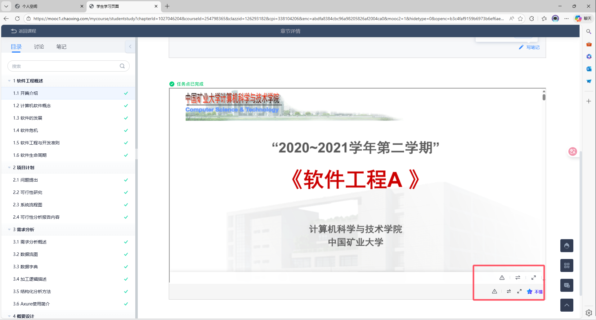
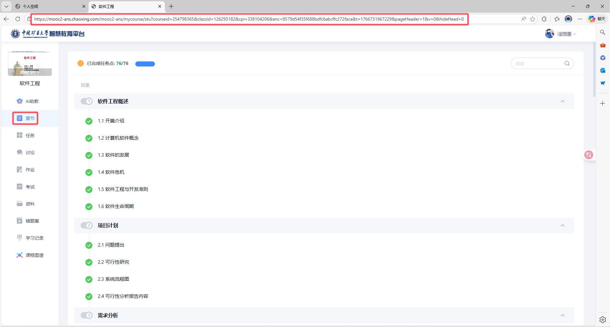
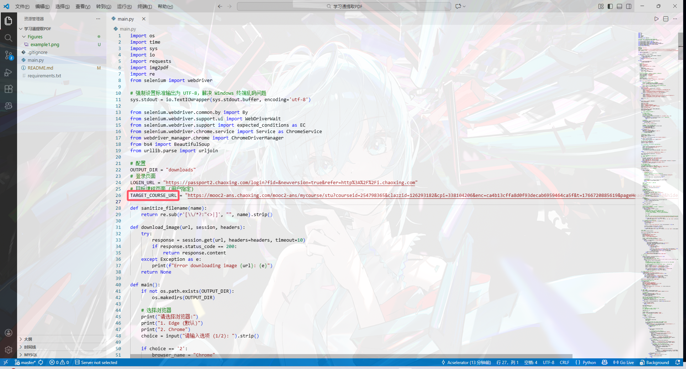

**This repository is paused. Please visit the new repository at https://github.com/Acselerator/chaoxing-pdf-grabber**

---

# Xuexitong Course PDF Extractor (Chaoxing PDF Extractor)

[](https://www.python.org/)
[](./LICENSE)

This is an automated script designed to extract chapter content (PPTs, document images) from Xuexitong (Chaoxing) course pages and save them as PDF files.

## 📖 Project Background

In many Xuexitong courses, instructional PPTs are often directly embedded within the course chapter pages, with no official download button provided. This creates inconvenience for offline reading, material organization, and subsequent AI-assisted analysis.



**This tool aims to solve this pain point**: It automatically iterates through course chapters, captures embedded PPT images, and losslessly merges them into PDF documents, making knowledge readily accessible.

## ✨ Features

- **Multi-browser Support**: Compatible with **Microsoft Edge** (default) and **Google Chrome**.
- **Fully Automated Traversal**: Simply provide the course homepage link, and the script will automatically parse the sidebar to batch-fetch all chapters.
- **Smart Archiving**: Automatically identifies the course name, creates a dedicated folder, and names/archives PDFs in chapter order.
- **Convenient Login**: Automatically opens the browser upon launch, supporting QR code or captcha login without complex cookie configuration.
- **Deep Extraction**: Automatically recognizes and extracts PPT and document images from pages, intelligently handling complex nested Iframe structures.
- **Detailed Feedback**: Provides clear progress logs, including notifications for detecting and handling images with alpha channels.

## 🔧 Implementation Principles

The core logic of this tool is based on the **Selenium** automation framework and the **BeautifulSoup** parsing library:

1.  **Simulated Login & Navigation**: Uses Selenium to drive the browser (Edge/Chrome), allowing users to manually complete login (bypassing complex captchas), then automatically navigates to the target course page.
2.  **Sidebar Parsing**: Utilizes BeautifulSoup to parse the HTML of the course homepage, extracting the names, IDs, and link parameters of all chapters from the sidebar.
3.  **Recursive Iframe Penetration**: Course content on Xuexitong is usually nested in multiple layers of Iframes (`iframe` -> `ans-attach-ct` -> `iframe`). The script implements a recursive search algorithm to automatically locate the innermost Iframe containing the PPT images (typically containing the `panView` element).
4.  **HD Image Extraction**: Instead of taking screenshots, the script directly extracts the original image URLs from the DOM (usually high-definition resources), ensuring the generated PDF matches the clarity of the web version.
5.  **Lossless PDF Generation**: After downloading images, the `img2pdf` library is used to losslessly merge the image sequence into a PDF file, preserving alpha channel information from the original images (if any).

## 🛠️ Environment Requirements

- **Operating System**: Windows / macOS / Linux
- **Programming Language**: Python 3.8+
- **Browser**: Microsoft Edge or Google Chrome

## 📦 Installation Steps

1.  **Get the Code**
    Clone the repository or download the zip archive locally:
    ```bash
    git clone https://github.com/your-username/chaoxing-pdf-extractor.git
    cd chaoxing-pdf-extractor
    ```

2.  **Install Dependencies**
    Run the following commands in your terminal to install the required Python libraries:
    ```bash
    - Create virtual environment (folder named venv)
    python -m venv venv

    - Activate virtual environment
    # Windows:
    .\venv\Scripts\activate

    # macOS / Linux:
    source venv/bin/activate
    
    pip install -r requirements.txt
    ```
3.  **Prepare Drivers (Optional)**
    *   **Chrome Users**: The script includes built-in automatic driver management, so no action is usually required. If you encounter network issues, manually download `chromedriver.exe` and place it in the project root directory.
    *   **Edge Users**: The script defaults to calling the system Edge. If it fails to start, download the corresponding `msedgedriver.exe` and place it in the project root directory.

## 🚀 Usage Guide

### Step 1: Configure Target Course
Open the `main.py` file and locate the `TARGET_COURSE_URL` variable. Change it to the link of the course page you want to download (usually the page containing the chapter list on the left).



```python
# main.py
TARGET_COURSE_URL = "https://mooc2-ans.chaoxing.com/..." 
```


### Step 2: Run the Script
Execute in your terminal:
```bash
python main.py
```

### Step 3: Select Browser
Upon launch, the script will prompt you to select a browser. Enter the number and press Enter:
```text
Please select a browser:
1. Edge (default)
2. Chrome
```

### Step 4: Log In
The browser will automatically open the Xuexitong login page. Please complete the login manually (QR code scan is recommended).
**Note**: After successful login and viewing the chapter list, return to the terminal window.

### Step 5: Start Downloading
Press **Enter** in the terminal window. The script will automatically start working, parsing chapters and downloading PDFs to the `downloads/course_name/` directory.

## ⚠️ Notes

*   **Anti-block Mechanism**: For safety, the script includes a brief delay during page navigation. Please be patient.
*   **Content Support**: Currently, it primarily supports extracting PPTs and documents in **image format**. Pure video chapters may be skipped.
*   **Alpha Channel Warning**: The console message "Image contains an alpha channel" is normal. The script will automatically handle it and preserve the original image quality.

## 📝 FAQ

**Q: Error `NoSuchWindowException`?**
A: Do not manually close the browser window while the script is running.

**Q: Error `Unable to obtain driver`?**
A: This is usually caused by a network issue failing the driver download. Try manually downloading the corresponding browser driver (Chromedriver or EdgeDriver) and placing it in the script directory.

## ⚖️ Disclaimer

1.  **For Learning & Exchange Only**: This project is strictly for personal learning and technical exchange, aiming to assist users with more convenient offline studying.
2.  **Legal & Compliant Use**: Do not use this tool for any commercial or illegal purposes. When using this tool, please comply with relevant laws, regulations, and the terms of service of the target website (Xuexitong/Chaoxing).
3.  **Data Security**: This tool does not collect any user account information or personal privacy data. All operations are performed locally on the user's machine.
4.  **Limitation of Liability**: The developers are not responsible for any direct or indirect losses arising from the use of this tool (including but not limited to account bans, data loss, etc.). Users assume all risks associated with its use.

## 📄 License

MIT License
